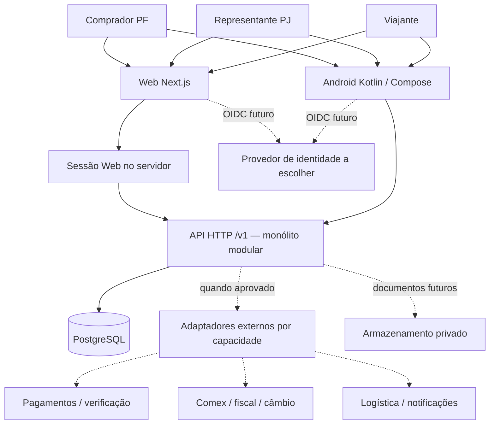

# Arquitetura proposta — Web, Android, PF e PJ

Estado: **direção aprovada em U-05**. Base: [descoberta](../product/discovery.md), U-01 a U-06. ADRs [0001](decisions/0001-stack-and-boundaries.md), [0002](decisions/0002-identity-and-ownership.md) e [0003](decisions/0003-integration-boundaries.md) aceitos. Fundação de orquestração implementada; aplicação SaaS ainda não implementada. U-06 determina Podman para workers e builds.

## 1. Direção recomendada

Monólito modular com API HTTP independente dos clientes. Web em Next.js/TypeScript, Android em Kotlin/Jetpack Compose e PostgreSQL como banco transacional. Regras de autorização, capacidade, cotação e estados comerciais pertencem ao backend. Clientes compartilham contrato, não cópias das regras fiscais.

Essa escolha é um julgamento de engenharia para um produto com duas interfaces, operações financeiras e documentos. A velocidade real depende da experiência da equipe, ainda desconhecida. Se predominar experiência Java/Kotlin, Spring Boot é alternativa forte; não há evidência para descartar essa opção.



Linhas pontilhadas representam capacidades planejadas, sem conexão ou provisionamento. Até a aprovação de identidade externa, testes usam emissor local de teste isolado e explicitamente incompatível com produção; nenhum acesso público usa autenticação simulada.

## 2. Comparação da stack

| Área | Opção recomendada e motivação | Alternativas e tradeoffs |
| --- | --- | --- |
| Web | Next.js + TypeScript: páginas públicas, área autenticada e sessão no servidor numa base | React/Vite: menor complexidade se tudo for SPA e SEO não importar. Next exige disciplina de cache e fronteiras servidor/cliente; nunca colocar domínio financeiro em Server Actions |
| Android | Kotlin + Compose: integração nativa, ciclo de vida e testes de UI; bom encaixe para uso durante viagem | React Native: reaproveita linguagem TS, exige avaliar plugins nativos. Flutter: UI consistente, adiciona Dart. Nenhuma elimina regras específicas de Android nem a necessidade de testes reais |
| API | NestJS + Fastify: módulos, injeção e organização consistentes; TS entre Web e backend | Fastify direto: menos framework, equipe deve manter convenções. Spring Boot: ecossistema forte de transações e segurança, JVM extra no backend e potencial vantagem se equipe dominar Kotlin/Java |
| Banco | PostgreSQL: transações, restrições, concorrência e relatórios relacionais | SQLite útil em testes específicos, insuficiente para substituir testes de concorrência do PostgreSQL. NoSQL não tem requisito que compense a perda do modelo relacional neste momento |
| Cache/fila | PostgreSQL e consultas indexadas inicialmente | Redis somente com medição de gargalo ou requisito concreto de coordenação. Outbox/worker só quando integrações assíncronas existirem |
| Workspace | npm workspaces para TS e Gradle Wrapper no Android | pnpm pode melhorar ergonomia/cache, mas não está instalado. Nx/Turborepo não se justificam antes de medir tempo de build |
| HTTP | OpenAPI como fonte versionada; JSON REST | GraphQL/gRPC aumentam superfície sem demanda demonstrada |
| Desenvolvimento | Compose para API/banco quando runtime de containers estiver validado | Podman pode ser usado se compatibilidade for verificada. Não exigir Docker Desktop nem Kubernetes |
| CI | GitHub Actions proposto pelo remote GitHub | Runner próprio só se custo/recursos Android exigirem; não pressupor planos, proteção ou secrets existentes |

Critérios: separação de domínio, manutenção, ferramentas de teste, integração Android, custo operacional e facilidade de auditoria. Não há benchmark ou estimativa financeira que demonstre superioridade absoluta de uma stack.

Versões exatas, ORM/driver de migração, bibliotecas OIDC, geração de clientes e ferramentas de lint/teste serão fixadas depois da aprovação, numa matriz compatível e com lockfiles. Node 22.14 e Java 27-ea locais não são automaticamente o runtime de produção. Há JDKs 17/21 no host; escolher JDK/Gradle/AGP juntos e verificar suporte. Sem instalar dependências nesta fase.

Referências de capacidade: [Nest/Fastify](https://docs.nestjs.com/techniques/performance), [Nest/OpenAPI](https://docs.nestjs.com/openapi/introduction), [Next.js](https://nextjs.org/docs/app/getting-started/installation), [arquitetura Android](https://developer.android.com/topic/architecture/recommendations), [requisitos Spring Boot](https://docs.spring.io/spring-boot/system-requirements.html). A recomendação é inferência aplicada ao projeto, não uma exigência desses fornecedores.

## 3. Fronteiras do backend

| Módulo | Responsabilidade | Restrição |
| --- | --- | --- |
| Identity & Accounts | Vincular identidade externa, contexto PF/PJ, Membership e permissões | Não implementar servidor OAuth, não usar email como identidade estável |
| Trips | Rota, data, preço anunciado, capacidade e status da viagem | Capacidade publicada não é promessa de elegibilidade aduaneira |
| Requests & Matching | Produto e intenção de compra; busca determinística | Sem scraping do link nem ML inicial |
| Eligibility & Pricing | Regime elegível, classificação, bases de preço, política e câmbio | Regime desconhecido retorna pendência; não aplica franquia por padrão |
| Orders | Aceite, reserva, transições, responsáveis e cancelamento | Só efetiva reserva comercial após regras aprovadas |
| Payments | Estado financeiro, PSP, conciliação, estorno e repasse | Nunca supor que entrega significa pagamento liquidado |
| Fulfillment & Disputes | Eventos logísticos, prova de entrega, contestação e operação | Tracking de pacote/voo não confirma recebimento pelo comprador |
| Documents | Importação, notas de serviço/mercadoria, evidências e acesso | Cada tipo tem emissor/finalidade; PDF de relatório não equivale a documento fiscal |
| Audit & Notifications | Registro de ações e comunicação transacional | Sem dados pessoais desnecessários nos logs |

Começar com pacotes internos por módulo, sem microserviços. Cada módulo acessa seus repositórios e publica métodos de aplicação explícitos; outro módulo não escreve diretamente nas suas tabelas. Uma operação local pode usar transação compartilhada controlada pela camada de aplicação. Não introduzir event sourcing, CQRS ou barramento distribuído.

## 4. Propriedade PF/PJ e isolamento

Modelo proposto: `User` é pessoa autenticada; `Account` é proprietário comercial de tipo `PERSONAL` ou `ORGANIZATION`. Account pessoal aponta para um único dono; Account empresarial para uma Organization. Restrições de banco devem garantir exclusividade do tipo e impedir associações incompletas.

Usuário pode ter conta pessoal e memberships em várias empresas. Cada solicitação pertence exatamente a uma Account. Campo de contexto recebido no request nunca prova autorização: o backend verifica dono ou Membership ativa e a permissão da ação a cada operação. Não confiar num `tenant_id` enviado pelo cliente ou apenas em claims de token potencialmente desatualizados.

Papéis empresariais iniciais propostos: `ORG_ADMIN` administra membros e documentos; `BUYER` cria e acompanha solicitações. Alçadas, leitor contábil e aprovador são decisões futuras; não construir RBAC genérico. Verificação de poderes e verificação de existência do CNPJ são diferentes.

Viagens publicadas pertencem ao viajante. Solicitação começa privada ao comprador/empresa; só o envio explícito a um viajante concede acesso ao resumo necessário. Rascunho não é visível a viajantes. Posterior Order registra comprador, empresa representada e viajante como participantes; eles não compartilham todo o tenant ou os documentos fiscais uns dos outros. Cache, exports, downloads, filas e auditoria aplicam a mesma política.

Não é necessário banco por empresa nem infraestrutura por cliente. É necessário isolamento entre organizações e contas pessoais numa base compartilhada. RLS pode fornecer defesa adicional, mas exige desenho para pedidos com participantes de lados diferentes, contexto transacional e pool de conexões. Não considerar RLS implementado ou confiar no dono da tabela como prova de isolamento. [PostgreSQL — RLS](https://www.postgresql.org/docs/current/ddl-rowsecurity.html).

## 5. Autenticação e sessão

Direção proposta: OIDC Authorization Code com PKCE. Provedor ainda não escolhido; comparar serviço gerenciado e Keycloak na pesquisa de integrações. Login verifica identidade de sessão, enquanto KYC/KYB e poderes societários são controles independentes.

- Android: navegador do sistema, redirecionamento validado, PKCE; aplicativo público sem client secret. Guardar material de sessão pelo mecanismo compatível com Android Keystore, com rotação/revogação; não registrar tokens.
- Web: tokens ficam no servidor; navegador recebe cookie opaco `HttpOnly`, `Secure` e política `SameSite` compatível com o fluxo. Validar `state`/`nonce` e redirect; proteger operações contra CSRF, fixação de sessão e cache compartilhado.
- API: validar assinatura, issuer, audience, validade e escopo; autorizar recurso e empresa no servidor. Revogação de membership tem efeito em novas operações mesmo que o token ainda esteja válido.
- MFA proposta para operação, administração empresarial sensível e alteração de recebedor/repasse, com recuperação de conta a especificar.
- Testes de integração podem usar um emissor OIDC de teste com chaves próprias e fixtures. Startup de produção rejeita emissor, contas e adaptadores de teste.

Autenticação externa real permanece sujeita a aprovação específica, em conformidade com U-03. Referência nativa: [RFC 8252](https://www.rfc-editor.org/info/rfc8252/).

## 6. Dados e invariantes

PostgreSQL mantém contas, membros, viagens, solicitações, políticas, cotações e pedidos. Arquivos futuros ficam em armazenamento privado, com metadados e política de acesso no banco.

- Dinheiro: valor inteiro em unidade mínima com código ISO da moeda; em JSON usar representação de inteiro como string para evitar limites de precisão entre clientes. Banco `bigint` ou decimal exato conforme contrato aprovado. Nunca ponto flutuante binário para preço, taxa ou tributo.
- Câmbio: decimal exato, par, fonte, tipo compra/venda, data/hora, finalidade e validade. Conversão de exibição, câmbio fiscal e taxa executável de pagamento não são intercambiáveis.
- Peso: inteiro em gramas. Dimensões, volumetria, tarifa mínima e arredondamento ainda dependem de Q-06; não reservar por peso se outra restrição operacional for necessária.
- Datas: instantes UTC e timezone IANA da rota; datas civis de partida/chegada explícitas. Busca não deve deslocar o dia por fuso.
- Identificadores: opacos; imprevisibilidade não substitui autorização. Documentos fiscais PF/PJ protegidos separadamente.
- CPF/CNPJ: texto normalizado por esquema versionado, com valor de exibição e validação adequada. CNPJ alfanumérico já aparece na comunicação oficial de 2026; preservar letras e aceitar também identificadores numéricos existentes. Não converter identificadores em números. [Receita — CNPJ alfanumérico](https://www.gov.br/receitafederal/pt-br/assuntos/noticias/2026/julho/receita-federal-gera-o-primeiro-cnpj-em-formato-alfanumerico).
- `Quote` é snapshot imutável: entradas, componentes, arredondamento, regra, câmbio, validade e avaliação de elegibilidade. Editar item/viagem ou expirar cotação exige nova versão e consentimento.
- `Reservation`: no pedido vinculante, reservar atomicamente com bloqueio/atualização condicional e restrição de capacidade não negativa. Expiração/cancelamento liberam uma única vez. Dois compradores concorrentes não podem vender a mesma capacidade.
- Pagamentos: chave de idempotência, montante e moeda ligados ao pedido/versão; histórico de reembolsos/repasses e conciliação. Ledger contábil de partidas dobradas só será especificado se a responsabilidade financeira o exigir; não inventar carteira própria.
- Migrações: versionadas, revisão explícita, expandir→migrar→contrair; sem reset automático. Restore e reconciliação antes do lançamento; retenção legal pode limitar exclusão de documentos, não justificar guardar tudo indefinidamente.

## 7. Estados e responsabilidades

Separar intenção, compromisso e dinheiro. Nomes e transições abaixo são proposta, não contrato aprovado:

```text
Solicitação: DRAFT → SUBMITTED → ACCEPTED | REJECTED | CANCELLED
Elegibilidade: PENDING_REVIEW → ELIGIBLE | INELIGIBLE | UNSUPPORTED
Cotação: DRAFT → ISSUED → ACCEPTED | EXPIRED | SUPERSEDED
Pedido futuro: AWAITING_PAYMENT → CONFIRMED → IN_TRANSIT → DELIVERY_REPORTED → COMPLETED
Exceções futuras: CANCELLED / CUSTOMS_HOLD / DISPUTED
Financeiro futuro: CREATED → PENDING → SETTLED → PAYOUT_PENDING → PAID_OUT
Financeiro paralelo: REFUND_PENDING / REFUNDED / CHARGEBACK / RECONCILIATION_REQUIRED
```

`DELIVERY_REPORTED` não libera dinheiro sozinho. Regras de prova, partes autorizadas, janela de disputa e prazo máximo permitido pelo PSP precisam concordar. Aceitar solicitação não pode cobrar, importar ou representar aprovação fiscal implicitamente. Uma máquina de estados executável só deve ser implementada após especificação de cada transição.

## 8. Contrato e API

Arquivo proposto: `contracts/http/openapi.yaml`, OpenAPI 3.0.3 como ponto de partida de interoperabilidade, sem alegação de ser a versão mais recente. Confirmar suporte da geração TS/Kotlin antes de fixar a versão. [Especificação](https://spec.openapis.org/oas/v3.0.3.html).

O YAML é fonte de verdade antes de handlers. Recursos preliminares para VS-01: `GET /v1/me/accounts`, `POST /v1/trips`, `GET /v1/trips`, `POST /v1/purchase-requests`, `GET /v1/purchase-requests/{id}`. Método de contexto PF/PJ será fixado no contrato; o backend sempre o autoriza. Criação de empresas/membership nesta primeira fatia usa fixtures de teste; onboarding real é outra especificação.

Contrato define schemas, campos obrigatórios, limites de tamanho/valor, moedas, paginação, ordenação estável, auth e respostas de erro. Erro padronizado: código estável, mensagem segura, correlation ID e erros de campo; resposta não expõe existência de recurso privado. Não usar tipos internos de ORM como DTO público.

Gerar clientes TS e Kotlin em diretórios dedicados, sem edição manual. CI valida schema, exemplos, regeneração sem diff, resposta real do servidor contra contrato e mudanças incompatíveis. Documentação Swagger gerada pelo backend é uma visualização/checagem, não uma segunda fonte concorrente. Alteração incompatível exige nova versão/migração com convivência de clientes Android antigos, prazo de depreciação e critérios de suporte.

Idempotência para operações mutáveis sensíveis: vincular chave a ator/contexto/operação e hash do payload; repetição igual devolve resultado, repetição divergente é conflito. Prazo e comportamento de requisições concorrentes precisam constar no contrato.

## 9. Arquitetura dos clientes

Web separa componentes, camada de chamadas tipadas e sessão no servidor. Páginas com dados pessoais usam cache privado/desabilitado conforme necessidade; um contexto empresarial não reutiliza respostas de outro. Layout responsivo e acessibilidade de teclado/leitor de tela são critérios de aceitação. Nenhum segredo de provedor é exposto no bundle.

Android inicia com módulos/pacotes `ui`, `data` e cliente HTTP gerado. ViewModels expõem estado imutável; Compose segue fluxo unidirecional com coroutines/Flow. Repositório é acesso à API. Use cases adicionais só quando reduzirem complexidade real. Tratar carregamento, vazio, erro, sessão expirada, conexão interrompida e mudança PF/PJ. Testar ciclo de vida e restauração sem repetir criação. Não introduzir banco offline até haver requisito. [Recomendações oficiais](https://developer.android.com/topic/architecture/recommendations).

## 10. Integrações e execução assíncrona futura

Pesquisa detalhada em [integrations.md](integrations.md). Desenhar portas pequenas por caso de uso e dados internos independentes de IDs/status de fornecedor. Adaptadores reais, SDKs e credenciais não fazem parte da fase atual.

Quando uma integração aprovada exigir efeitos externos: gravar comando/outbox junto à transação local, executar worker do mesmo codebase, usar idempotência, registrar resultado e conciliar. Webhook entra autenticado, com deduplicação/inbox durável; processamento assíncrono verifica valor/moeda/contexto e transição válida. Retentativa com limite e fila de falhas visível à operação. Isso não garante entrega exatamente uma vez; garante processamento defensivo e recuperável.

O primeiro rascunho persistido não precisa de outbox nem worker. Não construir plataforma universal de integrações ou microserviços para permitir expansão.

## 11. Estrutura futura do repositório

```text
apps/web/                       Next.js, sessão e interface
apps/api/src/modules/           monólito por domínio
apps/android/                   Gradle Wrapper, Compose, ui/data
packages/api-client-ts/         gerado do contrato
contracts/http/openapi.yaml     contrato canônico
contracts/fixtures/             exemplos públicos sintéticos
apps/android/core/api/          cliente Kotlin gerado
specs/<feature-id>/             spec, plan, tasks, acceptance
docs/product/                   evidência e requisitos
docs/architecture/              visão, pesquisa, ameaças, ADRs
docs/engineering/               processo, comandos e decisões
scripts/                        verificação e worktrees após aprovação
.github/workflows/              CI após aprovação
.agents/roles/ e workflows/     fase posterior
AGENTS.md e GEMINI.md            fase posterior
```

É uma estrutura proposta. Nenhuma pasta vazia equivale a componente pronto; não criar boilerplate desconectado para preencher a árvore.

## 12. Operação, observabilidade e custos

Produção candidata: Web, API, PostgreSQL gerenciado, armazenamento privado quando necessário e IdP escolhido. Worker adicional apenas quando houver integração. Sem escolha de cloud, região ou recurso provisionado. Seleção deve comparar preço de base e por uso, suporte de backup/restore, tráfego, logs, dados no exterior, cold starts e custo de ambientes de teste. Não há base suficiente para estimativa monetária confiável hoje.

API deve ter health/readiness, logs estruturados com correlation ID, métricas de latência/erros, falhas de autenticação e operação. Integrações acrescentam atraso de webhook, falhas de conciliação e pendências de repasse. Logs não carregam CPF, token, endereço ou documento completo.

Backup automatizado e restore testado, migrations isoladas, configuração por ambiente e menor privilégio são requisitos de release. SLO, RPO/RTO e carga-alvo dependem de Q-09/Q-10. Proposta de orçamento técnico para validação, sem tratá-la como requisito: testar busca com 10 mil viagens sintéticas e 20 clientes concorrentes; usar medições para decidir índices/cache.

## 13. VS-01 — primeiro fluxo vertical recomendado

**Problema:** validar uma base comum PF/PJ entre Web, Android, API e persistência antes de assumir compromissos financeiros ou logísticos.

**Histórias:** viajante de teste publica viagem fictícia; comprador PF ou membro PJ autorizado seleciona contexto, busca rota/data e cria rascunho privado de solicitação; o mesmo usuário o consulta no outro cliente; usuário sem permissão não o acessa.

**Escopo proposto:** identidade de teste OIDC, Account/Membership, viagem e request em PostgreSQL, contrato/clients gerados, Web e Compose, migrações e CI propostos. Onboarding PJ real, cotação legal/fiscal, reserva, cobrança e despacho ficam fora dessa fatia, sem serem retirados do MVP comercial.

**Critérios de aceitação candidatos:**

1. PF e PJ são cenários explícitos no mesmo teste de ponta a ponta; não transformar tudo em conta pessoal.
2. Rascunho criado no Web é recuperado no Android pela API real; reiniciar API não perde estado.
3. Conta alheia, empresa sem membership, membro revogado e viajante sem envio não leem o rascunho.
4. Datas/fusos, resultado vazio, entrada inválida e falha de rede têm comportamento definido.
5. Reenvio com mesma chave de idempotência não cria duplicata; payload diferente gera conflito.
6. Rascunho não reserva capacidade nem aciona provedor. Catálogo e contas de teste são claramente identificados.
7. Testes de contrato e geração detectam divergência entre API e os dois clientes.
8. Pipeline executa verificações reais de backend/Web/Android; ausência de SDK ou banco causa falha, não sucesso parcial silencioso.

**TDD proposto:** escrever cenário de autorização/persistência falhando, confirmar causa esperada, implementar mínimo, executar regressão e refatorar; repetir nos clientes com teste de comportamento. A especificação detalhada e o plano ainda devem ser aprovados antes de iniciar código.

**Dependências:** aprovação da arquitetura e da especificação, matriz de versões e container/DB testável. **DoD:** critérios demonstrados, resultados de comandos registrados, revisão independente futura, documentação e migrações revisadas. Nenhuma dessas verificações existe ou passou hoje.
